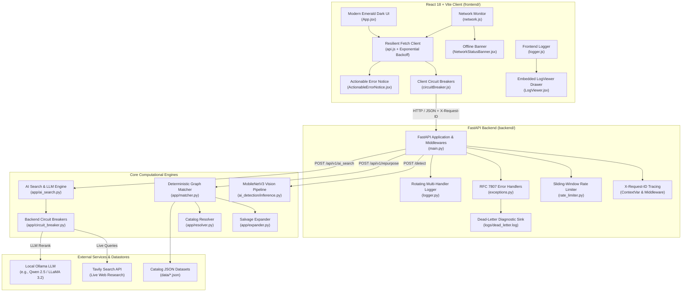

<div align="center">

# ♻️ ReWire: Give Dead Electronics a Second Life

### E-Waste Repurposing & Component Recovery Platform

*AI-powered platform that identifies components from a photo, matches them to verified maker projects, and measures the e-waste you keep out of landfill.*


</div>

---

## 📖 Table of Contents

- [Overview](#-overview)
- [Key Features](#-key-features)
- [System Architecture](#-system-architecture)
- [Tech Stack](#-tech-stack)
- [Repository Structure](#-repository-structure)
- [Core Subsystems](#-core-subsystems)
- [Resilience & Error Handling](#-resilience--error-handling)
- [Logging & Observability](#-logging--observability)
- [Getting Started](#-getting-started)
- [Configuration](#-configuration)
- [API Reference](#-api-reference)
- [Testing](#-testing)
- [Security & Privacy](#-security--privacy)
- [Roadmap](#-roadmap)
- [Contributing](#-contributing)
- [License](#-license)

---

## 🌍 Overview

Every year, tens of millions of metric tons of consumer electronics and industrial circuit boards are discarded, even though they contain thousands of working passives, microcontrollers, display panels, sensors, and power electronics.

**ReWire** is a full-stack hardware upcycling platform that bridges the gap between discarded hardware and high-utility maker projects. Users describe or photograph what they have, and ReWire tells them what they can build, what is still missing, and how many grams of e-waste they will divert.

This repository is a **monorepo** containing both halves of the application:

| Folder | Description |
| :--- | :--- |
| [`backend/`](./backend) | FastAPI service, deterministic matching engine, MobileNetV3 vision pipeline, and AI search layer |
| [`frontend/`](./frontend) | React 18 + Vite single-page "hardware workbench" client |

---

## ✨ Key Features

1. **Computer Vision Component Identification**
   Identify discrete electronic parts and devices from camera photos using a fine-tuned **MobileNetV3-Small** network, with an ambiguity guard that rejects low-confidence or near-tie predictions.

2. **Deterministic Constraint-Satisfaction Matcher**
   A local graph engine that analyzes your inventory, disassembles defective devices into salvaged sub-components, explores pin- and rating-compatible substitutions, scores project feasibility, and quantifies grams of diverted e-waste. It works with no cloud dependency.

3. **AI-Powered Live Research & LLM Reranking**
   Optional augmentation with **Tavily** live technical web search and **Ollama** local LLMs (e.g., Qwen 2.5, LLaMA 3.2) to synthesize build tutorials and rerank projects.

4. **Resilient, High-Availability Architecture**
   Circuit breakers on both client and server, sliding-window rate limiters, RFC 7807 problem details, exponential backoff with jitter, offline detection, and embedded live telemetry.

---

## 🏗 System Architecture



---

## 🧰 Tech Stack

| Layer | Technology | Version | Purpose |
| :--- | :--- | :--- | :--- |
| **Frontend Runtime** | Node.js / React | 18.x / 19.x (ESM) | Single-page reactive application |
| **Frontend Bundler** | Vite | 8.3+ | Fast HMR and optimized production builds |
| **Frontend Styling** | Custom CSS3 | - | Hardware workbench aesthetic (`#071811` emerald, `#b7f67c` accent, `DM Mono`) |
| **Backend Framework** | FastAPI | 0.115+ | High-performance asynchronous REST API |
| **ASGI Server** | Uvicorn | 0.34+ | Asynchronous server implementation |
| **Data Validation** | Pydantic | 2.10+ | Schema validation, serialization, and typing |
| **Deep Learning** | PyTorch & Torchvision | 2.0+ / 0.15+ | MobileNetV3-Small inference |
| **Fuzzy Matching** | RapidFuzz | 3.14+ | C++ accelerated Levenshtein matching for part names |
| **AI Agents & LLM** | LangChain-Ollama | 0.3+ | Integration with local Ollama models |
| **Live Web Search** | Tavily Python SDK | 0.5+ | Live retrieval of hardware build knowledge |
| **Testing** | Pytest & AnyIO | 9.x / 4.x | Automated backend test suite (66 tests) |
| **HTTP Client** | HTTPX | 0.28+ | Async test client and external HTTP requests |

---

## 📁 Repository Structure

```
rewire/
├── backend/                              # FastAPI service & ML pipeline
│   ├── ai_detection/                     # Deep learning vision subsystem
│   │   ├── config.py                     # MobileNetV3 hyperparameters & device setup
│   │   ├── dataset.py                    # PyTorch dataset loaders with albumentations
│   │   ├── inference.py                  # Real-time inference with ambiguity rejection
│   │   ├── ingest.py                     # Roboflow & web dataset ingestion pipeline
│   │   ├── model.py                      # MobileNetV3-Small architecture definition
│   │   ├── resolver.py                   # Neural class IDs -> catalog items
│   │   ├── schemas.py                    # Vision inference Pydantic models
│   │   └── train.py                      # Training loop with early stopping & metrics
│   ├── app/                              # Core application logic
│   │   ├── ai_search.py                  # Tavily + Ollama LLM reranking engine
│   │   ├── catalog.py                    # In-memory JSON catalog loader and indexes
│   │   ├── circuit_breaker.py            # Thread-safe circuit breaker
│   │   ├── config.py                     # Pydantic settings & environment loader
│   │   ├── exceptions.py                 # RFC 7807 domain exception hierarchy
│   │   ├── expander.py                   # Device salvage component expansion
│   │   ├── logger.py                     # Structured rotating multi-handler logger
│   │   ├── main.py                       # FastAPI entrypoint, routes, exception handlers
│   │   ├── matcher.py                    # Deterministic constraint matching
│   │   ├── rate_limiter.py               # Sliding-window rate limiter
│   │   ├── resolver.py                   # Component alias, SKU, and name resolver
│   │   ├── schemas.py                    # Request/response Pydantic schemas
│   │   ├── validation.py                 # Referential integrity validator for catalogs
│   │   └── waste.py                      # Gram-level e-waste calculations
│   ├── data/                             # Knowledge base & catalogs
│   │   ├── alias_collisions.json         # Alias collision tracking
│   │   ├── catalog_manifest.json         # Versioning and manifest
│   │   ├── component_catalog.json        # Electronic components & specs
│   │   ├── device_salvage_catalog.json   # Devices & salvage yields
│   │   ├── project_catalog.json          # Verified repurposing build projects
│   │   ├── substitution_catalog.json     # Pin/rating-compatible equivalents
│   │   └── validation_report.json        # Catalog health audit report
│   ├── logs/                             # Runtime telemetry & diagnostic sinks
│   │   ├── app.log                       # General application log
│   │   ├── error.log                     # Warnings and errors
│   │   ├── json.log                      # NDJSON structured telemetry
│   │   └── dead_letter.log               # Unhandled server exceptions
│   ├── models/mobilenetv3/               # Trained vision artifacts
│   │   ├── best_model.pth                # PyTorch weights checkpoint
│   │   ├── classes.json                  # Class index -> component mapping
│   │   ├── config.json                   # Input dimensions & normalization
│   │   └── evaluation_report.json        # Confusion matrix, top-1/top-5 accuracy
│   ├── tests/                            # Pytest suite (66 tests)
│   ├── .env.example                      # Environment variable template
│   └── requirements.txt                  # Python dependencies
│
├── frontend/                             # React 18 + Vite web application
│   ├── public/                           # Static assets
│   ├── src/
│   │   ├── components/
│   │   │   ├── ActionableErrorNotice.jsx # Interactive RFC 7807 error banner
│   │   │   ├── ErrorBoundary.jsx         # UI crash recovery boundary
│   │   │   ├── LogViewer.jsx             # Embedded real-time log drawer
│   │   │   ├── NetworkStatusBanner.jsx   # Offline detection & connection probe
│   │   │   └── Results.jsx               # Build recommendation cards & tutorials
│   │   ├── services/
│   │   │   ├── api.js                    # Resilient API client (backoff & retry)
│   │   │   ├── catalog.js                # Client-side catalog search & indexing
│   │   │   ├── circuitBreaker.js         # Client circuit breakers (AI & vision)
│   │   │   ├── logger.js                 # In-browser multi-level logger
│   │   │   └── network.js                # Connectivity monitor
│   │   ├── App.jsx                       # Workbench application state & layout
│   │   ├── main.jsx                      # React DOM mount point
│   │   └── styles.css                    # Global design tokens
│   ├── index.html                        # HTML5 shell
│   ├── package.json                      # Dependencies & Vite scripts
│   └── vite.config.js                    # Vite config with proxy rules
│
└── README.md
```

> Each component also ships a matching `.css` file (e.g. `Results.css`) alongside the `.jsx` file.

---

## 🧠 Core Subsystems

### 1. Deterministic Matcher & Salvage Engine

Runs entirely locally, giving immediate, offline-capable results.

1. **Inventory ingestion & normalization**: items are classified as `components` or `devices`, and quantities and conditions (`working`, `defective`) are validated.
2. **Recursive salvage expansion** (`app/expander.py`): a defective device (e.g., a broken microwave) is looked up in `device_salvage_catalog.json`. The engine filters out user-flagged defective parts, applies disassembly difficulty, and adds the salvaged components to the virtual parts pool.
3. **Component substitution** (`app/matcher.py`): when a project needs a specific part (e.g., an `LM7805` regulator or a `100uF 25V` capacitor), `substitution_catalog.json` is consulted. Compatible pinouts, higher voltage tolerances, and interchangeable ratings count as satisfied, with an audit note.
4. **Feasibility scoring**: each project is scored from 0 to 100:

   $$\text{Score} = \left(\frac{\text{Critical Satisfied}}{\text{Total Critical}}\right) \times 70 + \left(\frac{\text{Optional Satisfied}}{\text{Total Optional}}\right) \times 30$$

   Missing parts are compiled into a consolidated bill-of-materials shopping list.
5. **E-waste diversion** (`app/waste.py`): computes the net weight in grams of electronic waste diverted from landfill for every project candidate.

### 2. Computer Vision Inference

- **Model**: MobileNetV3-Small fine-tuned on discrete components (resistors, capacitors, ICs, relays, potentiometers, microcontrollers).
- **Pre-flight validation**: 15 MB size limit enforced before tensor loading; MIME check for `image/jpeg`, `image/png`, `image/webp`, `image/bmp`.
- **Ambiguity guard**: the top-1 probability is compared against `AI_CONFIDENCE_THRESHOLD` (default `0.55`). If the gap between the top two predictions, $\Delta = P_1 - P_2$, is below `0.10`, the result is flagged as ambiguous. This prevents confusing components with different safety ratings.
- **Catalog resolution** (`ai_detection/resolver.py`): maps neural class names to normalized IDs in `component_catalog.json`.

### 3. AI Research & Reranking

- **Hybrid retrieval**: deterministic candidates are augmented with live web research via the Tavily Search API.
- **LLM synthesis**: the user inventory and project templates are passed to Ollama (`qwen2.5:7b` or `llama3.2:3b`), which reranks by novelty, tools required, and beginner safety.
- **Graceful fallback**: if Tavily or Ollama times out, is rate-limited, or trips a circuit breaker, the client offers a one-click fallback to the deterministic matcher.

---

## 🛡 Resilience & Error Handling

### Backend

- **RFC 7807 Problem Details**: every error response follows a standardized envelope:

  ```json
  {
    "title": "Rate Limit Exceeded",
    "detail": "Too many requests sent in a short time frame.",
    "error_code": "RATE_LIMIT_EXCEEDED",
    "remediation": "Please wait 5 seconds before submitting another request.",
    "request_id": "req-9c84e1b8a21f",
    "timestamp": "2026-10-11T12:05:00.000Z",
    "path": "/detect",
    "details": {
      "limit": 30,
      "window_seconds": 60,
      "retry_after_seconds": 5
    }
  }
  ```

- **Sliding-window rate limiting** (`app/rate_limiter.py`): in-memory tracker returning HTTP `429` with a `Retry-After` header.
- **Circuit breakers** (`app/circuit_breaker.py`): thread-safe breakers for Tavily and Ollama. They trip after 3 consecutive network failures, cool down for 30 seconds, then probe recovery in a `HALF_OPEN` state.
- **Dead-letter sink**: unhandled `HTTP 500` exceptions are written to `logs/dead_letter.log` with timestamp, request ID, route, and full traceback. Client disconnects (`asyncio.CancelledError`) are ignored to avoid phantom alerts.

### Frontend

- **Client circuit breakers** (`circuitBreaker.js`): `aiSearchBreaker` and `visionBreaker` fast-fail when upstream services are down, preventing browser freezes and connection-pool exhaustion.
- **Exponential backoff with jitter** (`api.js`): retries transient network failures, `502`/`503`/`504`, and `429`. Delay is $T = \text{retryDelay} \times 2^{\text{attempt}} + \text{random}(0, 200)\,\text{ms}$, and the server's `Retry-After` header is respected when present.
- **Network status banner**: a sticky banner appears when offline, reassures the user that the local catalog still works, and offers a "Check Connection" probe.
- **Actionable error notice**: replaces generic alerts with a card showing the error code, status, title, a recommended action, a copyable correlation ID, and recovery buttons (**Retry Request** with countdown, **Run Standard ReWire** fallback).
- **React ErrorBoundary**: catches render crashes, logs telemetry, and resets state without losing the user's inventory.

---

## 🔭 Logging & Observability

| Layer | Capability |
| :--- | :--- |
| **Backend logs** | Rotating `app.log` (10 MB x 5 backups, `INFO+`), `error.log` (`WARNING+`), machine-readable NDJSON `json.log` (ready for Elasticsearch / Datadog / Grafana Loki), and `dead_letter.log` |
| **Request tracing** | Every request receives or generates an `X-Request-ID`, propagated via `contextvars.ContextVar` through logs, responses, and error envelopes |
| **Frontend logger** | Levels `DEBUG`, `INFO`, `WARN`, `ERROR`, `FATAL`, `PERF` with a circular buffer of the last 200 events |
| **LogViewer drawer** | In-app drawer (bottom-right) with live streaming, level/module filters, search, and one-click JSON export for bug reports |

---

## 🚀 Getting Started

### Prerequisites

- **OS**: Windows 10/11, macOS, or Linux (Ubuntu 22.04+ recommended)
- **Python**: 3.10 to 3.13
- **Node.js**: 18.x or 20.x+ with `npm`
- **Ollama** *(optional, for AI search)*: [install Ollama](https://ollama.ai), then pull a model:

  ```bash
  ollama pull qwen2.5:7b
  ```

### 1. Clone the repository

```bash
git clone https://github.com/<your-username>/<your-repo>.git
cd <your-repo>
```

### 2. Backend setup

```bash
cd backend
```

Create and activate a virtual environment:

```powershell
# Windows (PowerShell)
python -m venv myenv
.\myenv\Scripts\Activate.ps1
```

```bash
# Linux / macOS
python3 -m venv myenv
source myenv/bin/activate
```

Install dependencies and configure the environment:

```bash
pip install --upgrade pip
pip install -r requirements.txt
cp .env.example .env        # then edit .env (see Configuration below)
```

Start the API server:

```bash
uvicorn app.main:app --host 127.0.0.1 --port 8000 --reload
```

| Resource | URL |
| :--- | :--- |
| Interactive API docs (Swagger UI) | http://127.0.0.1:8000/docs |
| OpenAPI schema | http://127.0.0.1:8000/openapi.json |

### 3. Frontend setup

Open a **second terminal** from the repository root:

```bash
cd frontend
npm install
npm run dev
```

The app launches at **http://localhost:5173**. Vite proxies all `/api` and `/detect` requests to `http://127.0.0.1:8000`, so keep the backend running.

To create an optimized production build:

```bash
npm run build      # outputs static assets to frontend/dist/
```

---

## ⚙️ Configuration

Backend settings live in `backend/.env` (template: `backend/.env.example`).

| Variable | Example | Description |
| :--- | :--- | :--- |
| `CATALOG_STRICT` | `true` | Validate catalog referential integrity at startup; fail on broken component or salvage references |
| `AI_MODEL` | `qwen2.5:7b` | Ollama model used for LLM reranking |
| `TAVILY_API_KEY` | `tvly-...` | Tavily API key for live web research (required for AI search) |
| `AI_CONFIDENCE_THRESHOLD` | `0.55` | Minimum top-1 probability for a confident vision prediction |
| `AI_AMBIGUITY_DELTA` | `0.10` | Minimum gap between top-1 and top-2 probabilities before a prediction is flagged ambiguous |
| `AI_IMAGE_SIZE` | `224` | Model input resolution in pixels |
| `AI_DEVICE` | *(empty)* | Optional compute device override for PyTorch inference |

> ⚠️ Never commit your `.env` file or API keys.

---

## 📡 API Reference

| Method | Endpoint | Description | Rate Limit |
| :--- | :--- | :--- | :--- |
| `POST` | `/api/v1/repurpose` | Deterministic recommendations using catalog constraints and salvage expansion | 60 / min |
| `POST` | `/api/v1/ai_search` | AI-assisted search with live Tavily research and Ollama reranking | 20 / min |
| `POST` | `/detect` (alias `/api/v1/detect`) | Vision inference on an uploaded component/hardware image (max 15 MB) | 30 / min |

### `POST /api/v1/repurpose`

**Request**

```json
{
  "items": [
    {
      "name": "resistor_10k",
      "kind": "component",
      "quantity": 4,
      "condition": "working"
    },
    {
      "name": "broken_microwave",
      "kind": "device",
      "quantity": 1,
      "condition": "defective",
      "defective_components": ["magnetron"]
    }
  ],
  "options": {
    "max_results": 10,
    "min_score": 40,
    "max_difficulty": "high",
    "detail": "full",
    "include_best_combination": true
  }
}
```

**Response (`200 OK`)**

```json
{
  "summary": {
    "items_recognized": 2,
    "projects_ready": 3,
    "projects_almost": 2,
    "top_waste_reduction_grams": 1450
  },
  "recommendations": [
    {
      "project_id": "proj_high_voltage_supply",
      "project_name": "Variable Bench Power Supply",
      "tier": "ready",
      "feasibility_score": 92.5,
      "difficulty": "medium",
      "estimated_build_time": "2 hours",
      "waste_reduction_grams": 850,
      "requirements": [],
      "shopping_list": [],
      "build": {}
    }
  ]
}
```

> `requirements`, `shopping_list`, and `build` are abbreviated here for readability.

### `POST /api/v1/ai_search`

Accepts the same request schema as `/api/v1/repurpose` and returns the same response schema, extended with AI research summaries, community links, and LLM-synthesized build notes.

### `POST /detect`

Send `multipart/form-data` with an `image` field (JPEG, PNG, WEBP, or BMP).

```json
{
  "status": "success",
  "resolved": true,
  "normalized_inventory": {
    "name": "electrolytic_capacitor_100uf",
    "type": "component"
  },
  "prediction": {
    "class_id": 4,
    "class_name": "capacitor_electrolytic",
    "confidence": 0.892,
    "ambiguous": false
  }
}
```

---

## 🧪 Testing

From `backend/` with the virtual environment activated:

```bash
pytest tests -v
```

The suite contains **66 tests** across 12 modules covering the API, catalog integrity, matcher, salvage expander, fuzzy resolver, e-waste calculations, logging, and mocked Tavily/Ollama pipelines.

To run the error-handling and resilience tests on their own:

```bash
pytest tests/test_exceptions.py -v
```

These verify the RFC 7807 serialization, correlation ID propagation, the `422` validation envelope, `413` image-size rejection, remediation messages, circuit breaker trip/recovery, and `429` rate limiting with `Retry-After`.

---

## 🔒 Security & Privacy

- **Abuse prevention**: sliding-window rate limits protect resource-intensive ML routes. Uploads are capped at 15 MB and validated by magic-byte MIME inspection before processing.
- **Cascading-failure protection**: client and server circuit breakers isolate Tavily and Ollama from the core matcher. If AI providers go down, deterministic matching keeps working.
- **Data integrity**: startup catalog validation (`CATALOG_STRICT=true`) prevents broken component references or missing salvage items from degrading results.
- **Privacy by design**: deterministic matching and local Ollama inference keep component inventories on your machine unless cloud-backed features (Tavily web search) are enabled.

---

## 🗺 Roadmap

- [ ] **Live video detection**: real-time bounding-box detection over WebRTC/WebSocket to identify parts continuously as boards pass under a webcam
- [ ] **Community project contributions**: a Git-backed catalog submission pipeline for makers to propose new projects with verified schematics and video links
- [ ] **Automated PCB schematic parsing**: ingest Gerber files and KiCad schematics to auto-populate inventories from legacy PCB designs

---

## 🤝 Contributing

Contributions are welcome.

1. Fork the repository
2. Create a feature branch: `git checkout -b feature/your-feature`
3. Commit your changes: `git commit -m "Add your feature"`
4. Run the backend tests (`pytest tests -v`) and make sure the frontend builds (`npm run build`)
5. Push the branch and open a Pull Request

---

## 📄 License

Add your license here and include a `LICENSE` file at the repository root (for example, MIT).

---

<div align="center">

Built with ♻️ to give electronics a second life.

</div>