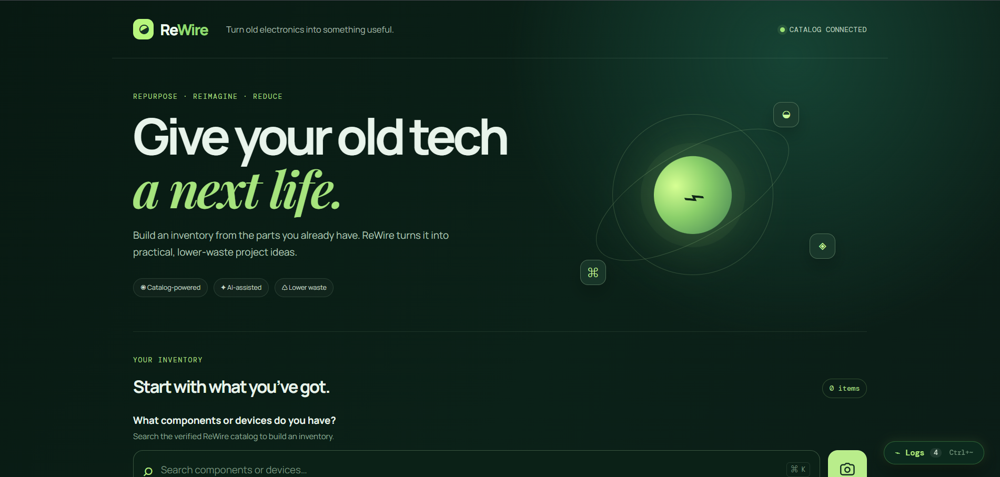
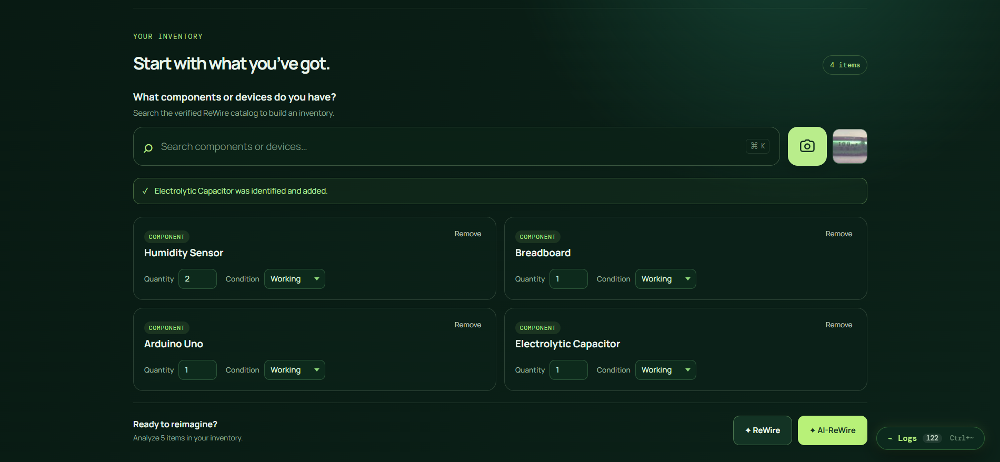
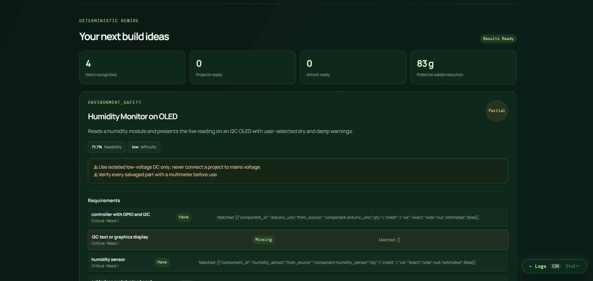
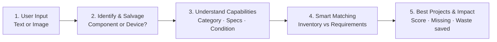
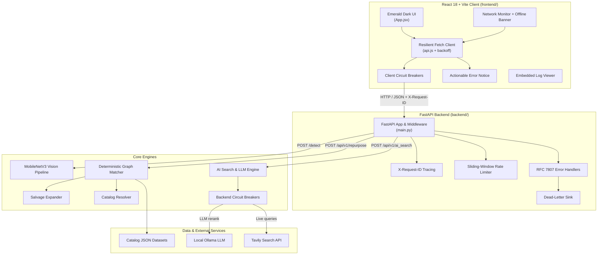

<div align="center">

# ♻️ ReWire: Give Dead Electronics a Second Life

### Every component has a second life — and every device can build something new.

An AI-powered e-waste repurposing platform that identifies discarded electronics, breaks old devices into reusable parts, and discovers what you can **actually build** from what you already have.


**SIMATS Hackathon · Problem Statement 03: SECONDLIFE · Team Dome Encore**

</div>

---

## 📖 Table of Contents

- [Overview](#-overview)
- [Screenshots](#-screenshots)
- [Key Features](#-key-features)
- [Why ReWire Is Different](#-why-rewire-is-different)
- [How It Works](#-how-it-works)
- [System Architecture](#-system-architecture)
- [Tech Stack](#-tech-stack)
- [Monorepo Structure](#-monorepo-structure)
- [Getting Started](#-getting-started)
- [Core Subsystems](#-core-subsystems)
- [Resilience & Observability](#-resilience--observability)
- [API Reference](#-api-reference)
- [Testing](#-testing)
- [Security & Privacy](#-security--privacy)
- [Roadmap](#-roadmap)
- [Team](#-team)

---

## 🌍 Overview

Every year, tens of millions of metric tons of consumer electronics and circuit boards are discarded, even though they contain thousands of working passives, microcontrollers, displays, sensors, and power components. Meanwhile, students and makers struggle to source affordable hardware for learning.

**ReWire** bridges that gap. Users describe their parts (or just upload a photo), and ReWire:

1. **Identifies** components and devices using computer vision.
2. **Disassembles** old devices into their potentially reusable sub-components.
3. **Matches** the resulting inventory against a capability-aware project catalog.
4. **Recommends** feasible builds with a feasibility score, a shopping list for missing parts, and an estimate of the e-waste diverted from landfill.

### The Problem

| Problem | Impact |
| :-- | :-- |
| **Massive e-waste** | Functional electronic components are treated as trash instead of resources. |
| **Buried potential** | Unused hardware gathers dust in homes and labs. |
| **High barriers** | Makers and students struggle to source affordable hardware for learning. |

---

## 📸 Screenshots

<p align="center">
  
</p>
<p align="center"><em>Inventory workbench: enter components and devices manually or upload a photo.</em></p>

<p align="center">
  
</p>
<p align="center"><em>AI detection: components and devices are identified from uploaded images.</em></p>

<p align="center">
  
</p>
<p align="center"><em>Recommendations: ranked builds with feasibility score, missing parts, and waste reduction.</em></p>

---

## ✨ Key Features

- 🔍 **Computer Vision Identification**: a fine-tuned **MobileNetV3-Small** model recognises discrete components from camera photos, with an ambiguity guard to avoid misidentifying parts that have different safety ratings.
- 🧩 **Device → Component Salvage**: a defective microwave or an old phone isn't one part. ReWire expands it into its salvageable components before matching.
- ⚙️ **Deterministic Constraint-Satisfaction Matcher**: a local graph engine that works offline, handles pin/spec-compatible substitutions, and scores feasibility from 0 to 100.
- 🏷️ **Condition-Aware Reuse**: every item can be marked *Working*, *Unverified*, or *Defective*, so recommendations reflect real usability.
- 🌐 **AI Live Research & LLM Reranking** (optional): Tavily web search plus a local Ollama LLM synthesise build tutorials and rerank projects by novelty, tools required, and beginner safety.
- ♻️ **E-Waste Impact**: gram-level estimate of electronic waste diverted for every project candidate.
- 🛡️ **Production-Grade Resilience**: circuit breakers, rate limiting, RFC 7807 errors, retries with exponential backoff, offline detection, and an embedded log viewer.

---

## 🚀 Why ReWire Is Different

> **Identify → Map → Match → Build**
>
> *We don't just recommend a project; we discover what is actually buildable from what you already have.*

| # | Differentiator | What it means |
| :-: | :-- | :-- |
| 1 | **Multimodal e-waste understanding** | Start with text or an image; AI identifies the item before catalog mapping begins. |
| 2 | **Device → component intelligence** | Old devices are decomposed into reusable parts through a salvage catalog. |
| 3 | **Condition-aware reuse** | Working / Unverified / Defective status keeps faulty parts from being treated as fully usable. |
| 4 | **Many-to-many mapping** | One component fits many projects; one project needs many components. The engine evaluates the *combination*, not an isolated match. |
| 5 | **Capability-aware matching** | Projects are matched on function, not just names: `Buzzer → emits_sound → audio requirement`. |

---

## 🔄 How It Works



Example of capability mapping, where components are connected by what they *do*:

```
Component  →  Category  →  Capability   →  Requirement
Buzzer     →  Output    →  emits_sound  →  audio requirement
```

---

## 🏗️ System Architecture



---

## 🧰 Tech Stack

| Layer | Technology | Purpose |
| :-- | :-- | :-- |
| **Frontend** | React 18 (ESM), Vite 8+ | Single-page app with fast HMR and optimised builds |
| **Styling** | Custom CSS3 | "Hardware workbench" aesthetic (`#071811` emerald, `#b7f67c` accent, DM Mono) |
| **Backend** | FastAPI 0.115+, Uvicorn 0.34+ | High-performance asynchronous REST API |
| **Validation** | Pydantic 2.10+ | Schema validation and serialisation |
| **Deep Learning** | PyTorch 2.0+, Torchvision 0.15+ | MobileNetV3-Small inference |
| **Fuzzy Matching** | RapidFuzz 3.14+ | Fast string matching for part names and aliases |
| **LLM** | LangChain-Ollama 0.3+ (Qwen 2.5 / LLaMA 3.2) | Local LLM reranking and synthesis |
| **Web Research** | Tavily Python SDK 0.5+ | Live technical web search |
| **Testing** | Pytest 9, AnyIO 4, HTTPX 0.28+ | 66-test backend suite |

---

## 📂 Monorepo Structure

```
rewire/
├── backend/                         # FastAPI service & ML pipeline
│   ├── ai_detection/                # MobileNetV3 vision subsystem
│   │   ├── config.py                # Hyperparameters & device setup
│   │   ├── dataset.py               # PyTorch dataset loaders (albumentations)
│   │   ├── inference.py             # Inference with ambiguity rejection
│   │   ├── ingest.py                # Roboflow & web dataset ingestion
│   │   ├── model.py                 # MobileNetV3-Small architecture
│   │   ├── resolver.py              # Neural class IDs → catalog items
│   │   ├── schemas.py               # Vision Pydantic models
│   │   └── train.py                 # Training loop, early stopping, metrics
│   ├── app/                         # Core application logic
│   │   ├── ai_search.py             # Tavily + Ollama reranking engine
│   │   ├── catalog.py               # In-memory catalog loader & indexes
│   │   ├── circuit_breaker.py       # Thread-safe circuit breaker
│   │   ├── config.py                # Pydantic settings & env loader
│   │   ├── exceptions.py            # RFC 7807 exception hierarchy
│   │   ├── expander.py              # Device salvage expansion engine
│   │   ├── logger.py                # Rotating multi-handler logger
│   │   ├── main.py                  # Entrypoint, routes, exception handlers
│   │   ├── matcher.py               # Deterministic constraint matcher
│   │   ├── rate_limiter.py          # Sliding-window rate limiter
│   │   ├── resolver.py              # Alias / SKU / name resolver
│   │   ├── schemas.py               # Request & response schemas
│   │   ├── validation.py            # Catalog referential-integrity validator
│   │   └── waste.py                 # Gram-level e-waste calculations
│   ├── data/                        # Knowledge base
│   │   ├── component_catalog.json
│   │   ├── device_salvage_catalog.json
│   │   ├── project_catalog.json
│   │   ├── substitution_catalog.json
│   │   ├── catalog_manifest.json
│   │   ├── alias_collisions.json
│   │   └── validation_report.json
│   ├── logs/                        # app / error / json / dead_letter logs
│   ├── models/mobilenetv3/          # Trained weights, classes, eval report
│   ├── tests/                       # Pytest suite (66 tests)
│   ├── .env.example
│   └── requirements.txt
│
├── frontend/                        # React 18 + Vite web app
│   ├── public/
│   ├── src/
│   │   ├── components/              # ActionableErrorNotice, ErrorBoundary,
│   │   │                            # LogViewer, NetworkStatusBanner, Results
│   │   ├── services/                # api, catalog, circuitBreaker, logger, network
│   │   ├── App.jsx                  # Workbench state & layout
│   │   ├── main.jsx                 # React DOM mount
│   │   └── styles.css               # Global design tokens
│   ├── index.html
│   ├── package.json
│   └── vite.config.js               # Dev proxy rules
│
├── screenshots/                     # README images (img1–img3)
└── README.md
```

---

## ⚡ Getting Started

### Prerequisites

| Requirement | Version |
| :-- | :-- |
| Python | 3.10 – 3.13 |
| Node.js | 18.x or 20.x+ (with `npm`) |
| Ollama *(optional, for AI-ReWire)* | [Install Ollama](https://ollama.ai) |
| OS | Windows 10/11, macOS, or Linux (Ubuntu 22.04+ recommended) |

If you want the AI-assisted mode, pull a local model first:

```bash
ollama pull qwen2.5:7b
```

### 1. Clone the repository

```bash
git clone https://github.com/<your-username>/<your-repo>.git
cd <your-repo>
```

### 2. Backend setup

```bash
cd backend

# Create & activate a virtual environment
python -m venv myenv
# Windows (PowerShell)
.\myenv\Scripts\Activate.ps1
# Linux / macOS
source myenv/bin/activate

# Install dependencies
pip install --upgrade pip
pip install -r requirements.txt

# Configure environment
cp .env.example .env
```

Key environment variables in `.env`:

```env
CATALOG_STRICT=true
AI_MODEL=qwen2.5:7b
TAVILY_API_KEY=tvly-your-tavily-api-key-here
AI_CONFIDENCE_THRESHOLD=0.55
AI_AMBIGUITY_DELTA=0.10
AI_IMAGE_SIZE=224
AI_DEVICE=
```

| Variable | Description |
| :-- | :-- |
| `CATALOG_STRICT` | Validates catalog referential integrity at startup. |
| `AI_MODEL` | Ollama model used for LLM reranking. |
| `TAVILY_API_KEY` | API key for live web research (AI mode only). |
| `AI_CONFIDENCE_THRESHOLD` | Minimum top-1 probability for a vision prediction. |
| `AI_AMBIGUITY_DELTA` | Minimum gap between top-1 and top-2 to avoid an "ambiguous" flag. |
| `AI_IMAGE_SIZE` | Model input size in pixels. |
| `AI_DEVICE` | Torch device override (leave blank for auto). |

Start the server:

```bash
uvicorn app.main:app --host 127.0.0.1 --port 8000 --reload
```

- Swagger UI → http://127.0.0.1:8000/docs
- OpenAPI schema → http://127.0.0.1:8000/openapi.json

### 3. Frontend setup

Open a second terminal:

```bash
cd frontend
npm install
npm run dev
```

The app launches at **http://localhost:5173**. Vite proxies all `/api` and `/detect` requests to `http://127.0.0.1:8000`.

Build for production (output in `dist/`):

```bash
npm run build
```

---

## 🧠 Core Subsystems

### 1. Deterministic Matcher & Salvage Engine

Runs entirely locally and returns results immediately, with no cloud dependency.

1. **Inventory ingestion**: items are classified as `components` or `devices`; quantities and conditions are validated.
2. **Recursive salvage expansion** (`app/expander.py`): defective devices are looked up in the salvage graph, user-flagged defective parts are filtered out, and the remaining yield (adjusted for disassembly difficulty) joins the virtual parts pool.
3. **Substitution engine** (`app/matcher.py`): if a project needs an `LM7805` or a `100µF 25V` capacitor, compatible pinouts and higher-rated equivalents count as satisfied, with an audit note.
4. **Feasibility scoring**: each project is scored from 0 to 100:

$$
\text{Score} = \left(\frac{\text{Critical Satisfied}}{\text{Total Critical}}\right) \times 70 + \left(\frac{\text{Optional Satisfied}}{\text{Total Optional}}\right) \times 30
$$

   Missing parts are compiled into a consolidated bill-of-materials shopping list.
5. **E-waste diversion** (`app/waste.py`): computes the net grams of electronic waste kept out of landfill per project.

### 2. Computer Vision Subsystem

- **Model**: MobileNetV3-Small fine-tuned on resistors, capacitors, ICs, relays, potentiometers, microcontrollers, and more.
- **Pre-flight validation**: 15 MB size cap and MIME check (`jpeg`, `png`, `webp`, `bmp`) before tensor loading.
- **Ambiguity guard**: a prediction is flagged ambiguous if top-1 confidence is below `AI_CONFIDENCE_THRESHOLD` (default `0.55`) or if `P₁ − P₂ < 0.10`, preventing mix-ups between parts with different safety ratings.
- **Catalog resolution**: neural class names are mapped to normalised IDs in `component_catalog.json`.

### 3. AI Research & Reranking (optional)

- **Hybrid retrieval**: deterministic candidates are augmented with live Tavily research.
- **LLM synthesis**: Ollama (`qwen2.5:7b` or `llama3.2:3b`) reranks by novelty, tools required, and beginner safety.
- **Graceful fallback**: on timeouts, rate limits, or open circuit breakers, the UI offers a one-click fallback to the deterministic matcher.

---

## 🛡️ Resilience & Observability

### Backend

| Mechanism | Details |
| :-- | :-- |
| **RFC 7807 problem details** | All errors share one envelope: title, detail, `error_code`, remediation advice, `request_id`, path, and context. |
| **Sliding-window rate limiting** | `/detect` 30 req/min · `/api/v1/ai_search` 20 req/min · `/api/v1/repurpose` 60 req/min. Returns `429` with `Retry-After`. |
| **Circuit breakers** | Thread-safe breakers for Tavily and Ollama. Trip after 3 consecutive failures, cool down 30 s, then probe in `HALF_OPEN`. |
| **Dead-letter sink** | Unhandled `500`s are written to `logs/dead_letter.log` with timestamp, request ID, route, and traceback. |
| **Request tracing** | Every request carries an `X-Request-ID`, propagated through logs, responses, and errors via `contextvars`. |
| **Rotating logs** | `app.log` (INFO+), `error.log` (WARNING+), `json.log` (NDJSON for ELK / Datadog / Loki), `dead_letter.log`. 10 MB × 5 backups. |

<details>
<summary><b>Example error response</b></summary>

```json
{
  "title": "Rate Limit Exceeded",
  "detail": "Too many requests sent in a short time frame.",
  "error_code": "RATE_LIMIT_EXCEEDED",
  "remediation": "Please wait 5 seconds before submitting another request.",
  "request_id": "req-9c84e1b8a21f",
  "path": "/detect",
  "details": {
    "limit": 30,
    "window_seconds": 60,
    "retry_after_seconds": 5
  }
}
```

</details>

### Frontend

- **Client circuit breakers**: fast-fail calls to the AI-search and vision services when upstreams are failing.
- **Exponential backoff with jitter**: retries transient failures (`502`/`503`/`504`) and `429`s, honouring the server's `Retry-After`:
  `T = retryDelay × 2^attempt + random(0, 200) ms`
- **Network status banner**: sticky offline alert with a "Check Connection" probe; reassures users that the local catalog still works offline.
- **Actionable error notice**: error code badge, human title, remediation steps, copyable correlation ID, a countdown **↻ Retry** button, and **✦ Run Standard ReWire** to fall back to deterministic matching.
- **React ErrorBoundary**: recovers from render crashes without losing the user's inventory.
- **Embedded LogViewer**: in-browser DevTools drawer with a 200-event ring buffer (`DEBUG`, `INFO`, `WARN`, `ERROR`, `FATAL`, `PERF`), level/module filters, search, and one-click JSON export for bug reports.

---

## 📡 API Reference

Interactive docs are served at `/docs` when the backend is running.

| Method | Endpoint | Description | Rate limit |
| :-: | :-- | :-- | :-: |
| `POST` | `/api/v1/repurpose` | Deterministic recommendations using catalog constraints and salvage expansion | 60/min |
| `POST` | `/api/v1/ai_search` | AI-assisted recommendations (Tavily research + Ollama reranking) | 20/min |
| `POST` | `/detect` *(alias `/api/v1/detect`)* | Vision inference on an uploaded image (max 15 MB) | 30/min |

### `POST /api/v1/repurpose`

<details>
<summary><b>Request</b></summary>

```json
{
  "items": [
    { "name": "resistor_10k", "kind": "component", "quantity": 4, "condition": "working" },
    {
      "name": "broken_microwave",
      "kind": "device",
      "quantity": 1,
      "condition": "defective",
      "defective_components": ["magnetron"]
    }
  ],
  "options": {
    "max_results": 10,
    "min_score": 40,
    "max_difficulty": "high",
    "detail": "full",
    "include_best_combination": true
  }
}
```

</details>

<details>
<summary><b>Response (200)</b></summary>

```json
{
  "summary": {
    "items_recognized": 2,
    "projects_ready": 3,
    "projects_almost": 2,
    "top_waste_reduction_grams": 1450
  },
  "recommendations": [
    {
      "project_id": "proj_high_voltage_supply",
      "project_name": "Variable Bench Power Supply",
      "tier": "ready",
      "feasibility_score": 92.5,
      "difficulty": "medium",
      "estimated_build_time": "2 hours",
      "waste_reduction_grams": 850,
      "requirements": [],
      "shopping_list": [],
      "build": {}
    }
  ]
}
```

</details>

### `POST /api/v1/ai_search`

Same request schema as `/repurpose`. The response adds AI research summaries, community links, and LLM-synthesised build notes.

### `POST /detect`

`multipart/form-data` with an `image` field (JPEG, PNG, WEBP, or BMP).

```bash
curl -X POST http://127.0.0.1:8000/detect -F "image=@capacitor.jpg"
```

<details>
<summary><b>Response (200)</b></summary>

```json
{
  "status": "success",
  "resolved": true,
  "normalized_inventory": {
    "name": "electrolytic_capacitor_100uf",
    "type": "component"
  },
  "prediction": {
    "class_id": 4,
    "class_name": "capacitor_electrolytic",
    "confidence": 0.892,
    "ambiguous": false
  }
}
```

</details>

---

## 🧪 Testing

From `backend/` with the virtual environment active:

```bash
pytest tests -v
```

```
collected 66 items
...
============================= 66 passed in 9.23s ==============================
```

Run only the error-handling and resilience tests:

```bash
pytest tests/test_exceptions.py -v
```

These verify RFC 7807 serialisation, correlation-ID propagation, the 422 validation envelope, 413 oversized-image rejection, remediation messages, circuit-breaker trip/reset behaviour, and `429` + `Retry-After` from the rate limiter.

---

## 🔒 Security & Privacy

- **Abuse prevention**: sliding-window rate limits on all resource-intensive routes; uploads capped at 15 MB and validated by magic-byte MIME inspection.
- **Cascading-failure protection**: front-end and back-end circuit breakers isolate Tavily and Ollama from the core matcher, so deterministic matching keeps working if AI providers go down.
- **Data integrity**: with `CATALOG_STRICT=true`, startup validation rejects broken component references and missing salvage items.
- **Privacy-first**: deterministic matching and Ollama inference run locally, so inventories stay on your machine unless cloud-backed features (Tavily search) are explicitly used.

---


<div align="center">

**Because every component has a second life, and every device can build something new.** 🌱

</div>