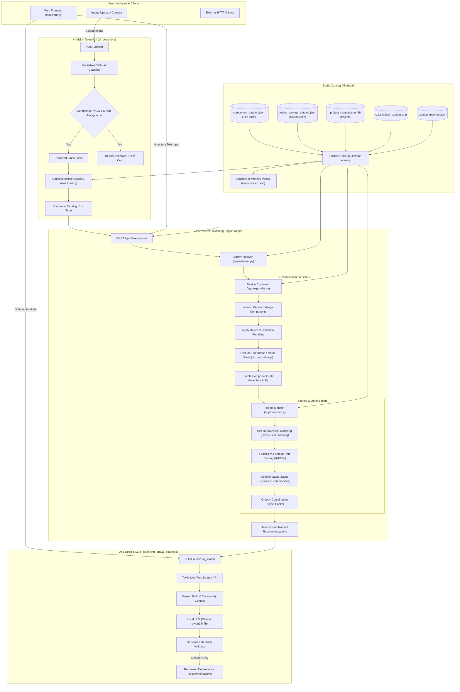

# Comprehensive Project Context: E-Waste Repurposing & AI Detection Platform

> **System Purpose**: An intelligent, deterministic, safety-enforced e-waste repurposing platform that turns discarded electronic devices and spare components into viable, safe, low-voltage DIY/maker projects. The system pairs deterministic catalog matching (single source of truth for engineering constraints) with an edge-ready MobileNetV3 image classifier for automated component identification and an optional local LLM + live web-search engine for re-ranking project viability.

---

## 1. System Architecture & Component Interaction



---

## 2. Tech Stack & Dependencies

| Layer / Domain | Technology | Purpose |
| :--- | :--- | :--- |
| **Language & Runtime** | **Python 3.10+** (Tested on Python 3.13) | Core backend runtime |
| **Web Framework** | **FastAPI** (`fastapi>=0.115.0`) | High-performance async REST API framework |
| **ASGI Web Server** | **Uvicorn** (`uvicorn>=0.34.0`) | Production ASGI server |
| **Validation & Schemas** | **Pydantic v2** (`pydantic>=2.10.0`) | Strict request/response typing and validation |
| **AI Vision (Classifier)** | **PyTorch** & **Torchvision** (`torch>=2.0.0`, `torchvision>=0.15.0`) | MobileNetV3-Small transfer-learning classifier for electronic components |
| **Image Processing** | **Pillow / PIL** (`pillow>=10.0.0`) | Image decoding, resizing, RGB conversion |
| **Fuzzy Matching** | **RapidFuzz** (`rapidfuzz>=3.14.0`) | Levenshtein-based fuzzy string resolution for user inputs and AI labels |
| **Local LLM Agent** | **LangChain-Ollama** (`langchain-ollama>=0.3.0`) | Structured ranking of recommendations via Ollama (`qwen2.5:7b`) |
| **Web Research** | **Tavily Search** (`tavily-python>=0.5.0`) | Focused online electronics tutorial and feasibility research |
| **Logging & Telemetry** | **Python Standard Logging** (`RotatingFileHandler`) | Synchronous and asynchronous file logging (`logs/app.log`, `logs/unrecognized.log`) + request latency middleware |
| **Testing** | **Pytest** & **HTTPX** (`pytest>=8.3.0`, `httpx>=0.28.0`) | Automated test suite (54 unit and integration tests) |
| **Frontend UI** | **Vanilla ES6 JS**, **HTML5**, **CSS3** | Zero-dependency client served statically by FastAPI |

---

## 3. Directory Layout

```text
RECYCLING PROJECT/
├── .env                              # Active environment configurations (Ollama model, Tavily API key)
├── .env.example                      # Template environment configuration file with documentation
├── .gitignore                         # Standard git ignore definitions
├── README.md                          # Project overview and catalog editing guide
├── requirements.txt                   # Production and testing Python dependencies
│
├── data/                              # Canonical Backend Catalogs (Single Source of Truth)
│   ├── component_catalog.json         # 142 discrete electronic components (specs, mass, tier)
│   ├── device_salvage_catalog.json    # 100 whole devices with salvageable component trees
│   ├── project_catalog.json           # 36 curated, safe, low-voltage DIY projects
│   ├── substitution_catalog.json      # Approved component substitution pairs and scores
│   ├── catalog_manifest.json          # Catalog version metadata
│   ├── alias_collisions.json          # Machine-readable report of multi-candidate aliases
│   └── validation_report.json         # Automated validator health report
│
├── app/                               # Core Application & API Logic
│   ├── __init__.py
│   ├── main.py                        # FastAPI entrypoint, lifespan event, CORS, API routes, logging
│   ├── config.py                      # App settings, paths, environment variable loader
│   ├── catalog.py                     # In-memory catalog caching and multi-index builder
│   ├── exceptions.py                  # Centralized domain exception hierarchy & error schemas
│   ├── schemas.py                     # Pydantic request, response, and domain models
│   ├── resolver.py                    # Multi-tiered inventory entity resolver
│   ├── expander.py                    # Device salvage expansion, defect, and safety handler
│   ├── matcher.py                     # Project slot matching, feasibility scoring, greedy packing
│   ├── ai_search.py                   # Tavily research + Ollama structured re-ranking service
│   └── validation.py                  # Catalog integrity and referential validation rules
│
├── ai_detection/                      # Computer Vision Subsystem (Independent Module)
│   ├── __init__.py
│   ├── config.py                      # Vision model hyperparameters, thresholds, and paths
│   ├── model.py                       # PyTorch MobileNetV3-Small architecture definition
│   ├── inference.py                   # ComponentClassifier inference engine
│   ├── resolver.py                    # CatalogResolver (predicted labels -> canonical IDs)
│   ├── train.py                       # Transfer learning training script
│   └── ingest.py                      # Dataset downloading, filtering, and deduplication
│
├── models/mobilenetv3/                # Trained AI Artifacts
│   ├── best_model.pth                 # PyTorch model weights checkpoint
│   ├── classes.json                   # Output classes list (14 classes)
│   ├── config.json                    # Model architecture and normalization config
│   └── evaluation_report.json         # Training metrics and confusion matrices
│
├── static/                            # Web Application Frontend Assets
│   ├── index.html                     # Single-page interface
│   ├── style.css                      # UI styling and responsive layouts
│   └── app.js                         # Dynamic state, API integration, camera UI, autocomplete
│
├── logs/                              # Active Runtime Log Files (Auto-Created)
│   ├── app.log                        # Rotating application operational logs (requests, detections, errors)
│   └── unrecognized.log               # Rotating audit log for unrecognized hardware inputs
│
├── scripts/                           # Build & CI Scripts
│   └── validate_catalogs.py           # Validates catalog consistency, references, and spec checks
│
├── docs/                              # Project Documentation
│   └── PROJECT_CONTEXT.md             # Complete project architecture, API specs, and guide
│
├── datasets/                          # Dataset metadata and image files
│   └── metadata/                      # Class mappings and ingestion source manifests
│
└── tests/                             # Comprehensive Automated Test Suite (58 Tests)
    ├── test_api.py                    # API endpoints integration tests
    ├── test_catalog.py                # Catalog loading and validation tests
    ├── test_exceptions.py             # Domain exception hierarchy and error envelope tests
    ├── test_resolver.py               # Fuzzy and exact resolver tests
    ├── test_expander.py               # Device salvage logic tests
    ├── test_matcher.py                # Feasibility scoring and slot tests
    ├── test_waste.py                  # Material waste reduction calculations
    ├── test_validation_coverage.py    # Catalog validation rules coverage
    ├── test_ai_api.py                 # Vision /detect endpoint tests
    ├── test_ai_resolver.py            # AI vision label resolver tests
    └── test_ai_search_api.py          # AI web-search and ranking endpoint tests
```

---

## 4. Logging & Telemetry Architecture

The logging system is built for high reliability, zero data-loss, and full traceability:

1. **Structured Log Formatter**:
   `%(asctime)s | %(levelname)-7s | [%(name)s] %(message)s`
2. **Dual-Channel Handlers**:
   * **Console Stream (`StreamHandler`)**: Real-time console output for developer feedback.
   * **Application Log File (`LOG_DIR / app.log`)**:
     * Implemented using `RotatingFileHandler` with `maxBytes=5_000_000` (5 MB) and `backupCount=5`.
     * Encoded in UTF-8.
     * Records all application lifecycle events, database/catalog loading, AI inferences, and error traces.
   * **Unrecognized Hardware Input Log (`LOG_DIR / unrecognized.log`)**:
     * Dedicated `RotatingFileHandler` (500 KB, 3 backups) logging user inputs that failed catalog resolution.
     * Used by catalog curators to identify high-demand orphan components.
3. **HTTP Request / Latency Middleware**:
   Every incoming HTTP request is intercepted, measured in milliseconds, and logged:
   `GET /static/vocab.json -> 200 (1.2ms) [127.0.0.1]`
   `POST /detect -> 200 (23.4ms) [127.0.0.1]`
4. **Domain Event Telemetry**:
   * `[DETECT]`: Logs file upload name, payload size, model predictions, confidence scores, and canonical catalog mappings.
   * `[REPURPOSE]`: Logs items received, recognized items count, matched project tiers (`ready`, `almost`), and estimated waste reduction in grams.

---

## 5. Dynamic In-Memory Vocabulary (No Static Files Required)

* **No Static Dump File**: Unlike legacy builds that required a pre-generated `static/vocab.json` file on disk, vocabulary is now generated dynamically in-memory on application startup (`lifespan`).
* **Route Precedence**: FastAPI routes `@app.get("/static/vocab.json")` and `@app.get("/vocab")` directly serve the dynamically indexed dictionary (242 entries) straight from in-memory `Catalogs`.
* **Zero Maintenance**: When catalog JSON files in `data/` are updated, restarting the server immediately updates the client autocomplete without running any static generator script.

---

## 6. How the System Works (End-to-End Workflow)

### Phase 1: AI Vision Identification (`/detect`)
1. User uploads a photograph containing an electronic part or discarded device.
2. The image is passed through `ComponentClassifier.predict()`:
   * Converted to RGB, resized to 224×224, normalized via ImageNet mean and standard deviation.
   * MobileNetV3-Small produces softmax probabilities.
   * If confidence $< 0.55$ or top-1/top-2 ambiguity delta $< 0.10$, the system returns `detected_label: "unknown"`.
3. If confident, `ai_detection.resolver.CatalogResolver` resolves the label:
   * Resolves against `data/component_catalog.json` and `data/device_salvage_catalog.json` across Exact ID $\rightarrow$ Exact Name $\rightarrow$ Exact Alias $\rightarrow$ Normalized Alias $\rightarrow$ RapidFuzz Fuzzy match.
   * Returns a canonical `resolved_id` (e.g. `arduino_uno` or `microwave_oven`) and `resolved_type` (`component` or `device`).
   * **Boundary Rule**: The vision module only identifies the object; it never performs salvage expansion or project matching.

### Phase 2: Inventory Resolution & Deconstruction (`app/resolver.py` & `app/expander.py`)
1. **User Inventory Input**: A list of items (e.g., `[{"name": "Microwave Oven", "kind": "device", "quantity": 1}, {"name": "LED", "kind": "component", "quantity": 5}]`).
2. **Entity Resolution**: `Resolver` matches user strings against catalog canonical IDs and aliases.
3. **Salvage Expansion**:
   * If an item is a **device**, `expand_inventory` fetches its salvageable components from `device_salvage_catalog.json`.
   * **Condition Factor**: Unknown condition applies $0.7\times$; unspecified defective condition applies $0.5\times$ and prompts the user to list likely failed parts.
   * **Defect Handling**: Parts marked defective receive zero inventory credit.
   * **Safety Exclusion**: Components marked `do_not_salvage` (mains transformers, magnetrons, CRT tubes, swollen lithium batteries) are filtered out into safety exclusion warnings.

### Phase 3: Deterministic Project Matching & Scoring (`app/matcher.py`)
1. **Candidate Retrieval**: In-memory inverted indexes locate projects that can utilize the available parts.
2. **Slot Matching**: Each project requirement slot is evaluated:
   * **Have**: Exact physical component available in inventory.
   * **Substitute**: Approved substitute from `data/substitution_catalog.json` (scored $0.0 \dots 1.0$).
   * **Missing**: Missing part added to shopping list with tier (`free`, `cheap`, `moderate`, `expensive`).
3. **Feasibility Scoring**:
   * Critical requirements must have non-zero availability.
   * Feasibility Score is computed from slot coverage weights ($0 \dots 100\%$).
   * Projects are assigned tiers: `ready`, `almost`, `partial`, `not_viable`.
4. **Waste Reduction Calculation**:
   * Sums mass in grams of all inventory components consumed by the project.
   * Categorizes waste reduction by commodity (copper, aluminum, plastics, silicon, etc.).
5. **Greedy Combination Packer**:
   * For larger inventories, calculates the optimal subset of multiple projects that can be built simultaneously without double-counting parts.

### Phase 4: Optional AI Research & Re-Ranking (`app/ai_search.py`)
* If requested via `/api/v1/ai_search`, recommendations are passed to `AISearchService`.
* Top candidate projects are researched using Tavily API for community build feedback and beginner feasibility.
* A local Ollama model (`qwen2.5:7b`) evaluates the research and outputs a structured Pydantic decision list (`AIProjectDecisions`).
* **Anti-Hallucination Sandbox**: The LLM **can only re-order** the validated deterministic projects. It cannot invent new projects, change slot requirements, or modify feasibility scores.

---

## 7. Catalog Schema Specifications (`data/`)

### `component_catalog.json` (142 components)
```json
{
  "id": "arduino_uno",
  "display_name": "Arduino Uno",
  "aliases": ["uno", "arduino board", "atmega328p board"],
  "category": "microcontroller",
  "capabilities": ["gpio", "programmable", "adc", "pwm"],
  "specs": {
    "voltage": "5V",
    "clock_speed_mhz": 16
  },
  "mass_g": 25.0,
  "commodity": "electronics_pcb",
  "acquisition_tier": "moderate",
  "hazard_note": null
}
```

### `device_salvage_catalog.json` (100 devices)
```json
{
  "device_id": "microwave_oven",
  "device_name": "Microwave Oven",
  "aliases": ["microwave"],
  "device_category": "home_appliance",
  "device_mass_g": 12000.0,
  "safety_level": "hazardous",
  "hazard_note": "High voltage capacitor and magnetron pose lethal shock risks.",
  "common_failure_components": ["magnetron", "high_voltage_diode"],
  "salvageable_components": [
    {
      "component_id": "cooling_fan",
      "typical_quantity": 1,
      "availability": "high",
      "extraction_difficulty": "easy",
      "reuse_suitability": "high",
      "do_not_salvage": false,
      "note": "Low voltage DC or AC fan"
    },
    {
      "component_id": "transformer",
      "typical_quantity": 1,
      "do_not_salvage": true,
      "note": "High voltage microwave transformer is extremely hazardous."
    }
  ]
}
```

### `project_catalog.json` (36 projects)
```json
{
  "project_id": "proj_dark_activated_night_light",
  "project_name": "Dark-Activated Night Light",
  "description": "An automatic low-voltage LED light that turns on in darkness using an LDR sensor.",
  "category": "automation",
  "difficulty": "low",
  "estimated_build_time_hours": 1.5,
  "safety_level": "low",
  "requirements": [
    {
      "requirement_id": "req_ldr",
      "role": "light sensor",
      "category": "sensor",
      "required_capabilities": ["measures_light"],
      "quantity": 1,
      "critical": true,
      "candidate_component_ids": ["ldr_light_sensor"],
      "allow_substitutes": true
    },
    {
      "requirement_id": "req_led",
      "role": "illumination",
      "category": "output_device",
      "required_capabilities": ["emits_light"],
      "quantity": 1,
      "critical": true,
      "candidate_component_ids": ["led"],
      "allow_substitutes": false
    }
  ],
  "optional_requirements": [],
  "spec_constraints": [],
  "build_instructions": {
    "prerequisites": ["Test salvaged LED with multimeter diode mode."],
    "steps": [
      {"step": 1, "title": "Breadboard setup", "instruction": "Insert transistor and connect LDR to base."},
      {"step": 2, "title": "Connect LED", "instruction": "Wire LED and current-limiting resistor to collector."}
    ],
    "wiring": [
      {"from": "ldr_light_sensor:pin1", "to": "vcc", "note": "Pull-up resistor divider"}
    ],
    "safety_notes": ["Low voltage DC only (5V). Do not connect to mains."]
  },
  "sources": [],
  "youtube_videos": [],
  "output": "Automatic night light"
}
```

---

## 8. Complete API Reference

### 1. Identify Component / Device (`POST /detect`)
Accepts an image file; runs MobileNetV3 inference; resolves to canonical catalog entity.

* **Endpoint**: `POST /detect` (or `POST /api/v1/detect`)
* **Content-Type**: `multipart/form-data`
* **Form Field**: `image` (binary file: JPG, PNG, WEBP, BMP)

#### Response (Success)
```json
{
  "detected_label": "Arduino Uno",
  "confidence": 0.9842,
  "resolved": true,
  "resolved_type": "component",
  "resolved_id": "arduino_uno",
  "resolution_confidence": 1.0,
  "normalized_inventory": {
    "name": "arduino_uno",
    "type": "component"
  }
}
```

#### Response (Ambiguous / Unknown)
```json
{
  "detected_label": "unknown",
  "confidence": 0.421,
  "resolved": false,
  "reason": "Object could not be confidently identified"
}
```

---

### 2. Match Inventory to Projects (`POST /api/v1/repurpose`)
Deterministic inventory expansion, salvage deconstruction, and project feasibility scoring.

* **Endpoint**: `POST /api/v1/repurpose`
* **Content-Type**: `application/json`

#### Request Payload
```json
{
  "items": [
    {
      "name": "arduino_uno",
      "kind": "component",
      "quantity": 1
    },
    {
      "name": "microwave_oven",
      "kind": "device",
      "quantity": 1,
      "condition": "defective",
      "defects": ["magnetron"]
    }
  ],
  "options": {
    "detail": "full",
    "max_difficulty": "medium",
    "min_score": 50.0,
    "max_results": 10,
    "include_best_combination": true
  }
}
```

#### Response Structure
```json
{
  "meta": {
    "catalog_version": "2026.10.05",
    "generated_at": "2026-10-05T00:00:00Z",
    "mode": "match"
  },
  "resolved_inventory": [
    {
      "input": "arduino_uno",
      "status": "exact",
      "matched_id": "arduino_uno",
      "kind": "component",
      "confidence": 1.0,
      "units": [
        {
          "component_id": "arduino_uno",
          "qty": 1,
          "estimated": false,
          "condition_factor": 1.0
        }
      ]
    }
  ],
  "unrecognized": [],
  "safety_banners": [
    "Device microwave_oven is categorized as hazardous. Lethal high-voltage hazards present; do not disassemble internal transformer or capacitor."
  ],
  "recommendations": [
    {
      "project_id": "proj_dark_activated_night_light",
      "name": "Dark-Activated Night Light",
      "category": "automation",
      "difficulty": "low",
      "estimated_build_time_hours": 1.5,
      "safety_level": "low",
      "tier": "ready",
      "feasibility_score": 100.0,
      "score_if_buying_cheap_parts": 100.0,
      "rank": 92.45,
      "requirements": [
        {
          "requirement_id": "req_ldr",
          "role": "light sensor",
          "critical": true,
          "needed": 1,
          "fill": 1.0,
          "status": "have",
          "satisfied_by": [
            {
              "lot_id": "lot_1",
              "component_id": "ldr_light_sensor",
              "qty": 1,
              "is_substitute": false
            }
          ]
        }
      ],
      "shopping_list": [],
      "waste_reduction": {
        "grams": 27.5,
        "pct_of_input": 0.23,
        "label": "estimate",
        "by_source": [
          {
            "component_id": "arduino_uno",
            "qty": 1,
            "grams": 25.0,
            "from_source": "arduino_uno"
          }
        ]
      },
      "warnings": [
        "Use isolated low-voltage DC only; never connect a project to mains voltage."
      ],
      "data_quality": {
        "needs_review": false,
        "confidence": "unknown",
        "review_reasons": []
      },
      "build": {
        "prerequisites": ["Test salvaged LED with multimeter diode mode."],
        "steps": [
          {"step": 1, "title": "Breadboard setup", "instruction": "Insert transistor..."}
        ],
        "wiring": [],
        "safety_notes": ["Low voltage DC only (5V)."]
      }
    }
  ],
  "best_combination": {
    "projects": ["proj_dark_activated_night_light"],
    "total_waste_grams": 27.5
  },
  "summary": {
    "items_recognized": 2,
    "projects_ready": 1,
    "projects_almost": 0,
    "top_waste_reduction_grams": 27.5
  }
}
```

---

### 3. AI-Enhanced Search & Re-ranking (`POST /api/v1/ai_search`)
Runs the deterministic matcher, initiates web research via Tavily for top candidates, and re-ranks recommendations via a local Ollama LLM.

* **Endpoint**: `POST /api/v1/ai_search`
* **Request & Response**: Same contract as `POST /api/v1/repurpose`.

---

### 4. Dynamic Vocabulary (`GET /static/vocab.json` & `GET /vocab`)
Dynamically serves the autocomplete vocabulary for all 142 components and 100 devices generated directly from backend memory.

* **Endpoints**: `GET /static/vocab.json`, `GET /vocab`
* **Response**: `{"catalog_version": "2026.10.05", "items": [...]}` (242 items)

---

---

## 9. Advanced Exception Handling & Resilience Architecture

The platform implements an enterprise-grade, strongly typed domain exception hierarchy in `app/exceptions.py`, unified global FastAPI exception handlers in `app/main.py`, and distributed correlation tracking for full observability and graceful failure modes.

### 1. Domain Exception Hierarchy

All application exceptions inherit from `EWasteBaseException`, providing predictable status codes, machine-readable error codes, human-readable details, and contextual metadata:

```mermaid
classDiagram
    class EWasteBaseException {
        +int status_code
        +str error_code
        +str message
        +Any details
        +to_dict() dict
    }

    class CatalogError {
        +error_code: CATALOG_ERROR
        +status_code: 500
    }
    class CatalogNotFoundError {
        +error_code: CATALOG_NOT_FOUND
        +status_code: 500
    }
    class CatalogCorruptedError {
        +error_code: CATALOG_CORRUPTED
        +status_code: 500
    }
    class CatalogValidationError {
        +error_code: CATALOG_VALIDATION_ERROR
        +status_code: 500
    }

    class VisionDetectionError {
        +error_code: VISION_ERROR
        +status_code: 400
    }
    class UnsupportedImageFormatError {
        +error_code: UNSUPPORTED_IMAGE_FORMAT
        +status_code: 400
    }
    class EmptyImageFileError {
        +error_code: EMPTY_IMAGE_FILE
        +status_code: 400
    }
    class CorruptedImageError {
        +error_code: CORRUPTED_IMAGE_FILE
        +status_code: 400
    }
    class ModelNotLoadedError {
        +error_code: MODEL_NOT_LOADED
        +status_code: 503
    }
    class InferenceRuntimeError {
        +error_code: INFERENCE_RUNTIME_ERROR
        +status_code: 500
    }

    class AISearchError {
        +error_code: AI_SEARCH_ERROR
        +status_code: 502
    }
    class AIConfigMissingError {
        +error_code: AI_CONFIG_MISSING
        +status_code: 503
    }
    class AIProviderUnavailableError {
        +error_code: AI_PROVIDER_UNAVAILABLE
        +status_code: 502 / 503
    }
    class AIInvalidOutputError {
        +error_code: AI_INVALID_OUTPUT
        +status_code: 502
    }

    EWasteBaseException <|-- CatalogError
    CatalogError <|-- CatalogNotFoundError
    CatalogError <|-- CatalogCorruptedError
    CatalogError <|-- CatalogValidationError

    EWasteBaseException <|-- VisionDetectionError
    VisionDetectionError <|-- UnsupportedImageFormatError
    VisionDetectionError <|-- EmptyImageFileError
    VisionDetectionError <|-- CorruptedImageError
    VisionDetectionError <|-- ModelNotLoadedError
    VisionDetectionError <|-- InferenceRuntimeError

    EWasteBaseException <|-- AISearchError
    AISearchError <|-- AIConfigMissingError
    AISearchError <|-- AIProviderUnavailableError
    AISearchError <|-- AIInvalidOutputError
```



### 2. Standardized Error Response Envelope

Every HTTP error response emitted by the platform conforms to a consistent JSON structure, guaranteeing complete backward compatibility with standard clients while providing modern operational tracing:

```json
{
  "detail": "Unsupported file type '.gif'. Allowed formats: BMP, JPEG, JPG, PNG, WEBP.",
  "error_code": "UNSUPPORTED_IMAGE_FORMAT",
  "request_id": "req-d3b2a198c7e6",
  "timestamp": "2026-10-10T18:28:45.123456+00:00",
  "path": "/detect",
  "details": {
    "extension": ".gif",
    "allowed": [".bmp", ".jpeg", ".jpg", ".png", ".webp"]
  }
}
```

| Field | Type | Description |
| :--- | :--- | :--- |
| `detail` | `str` \| `list` | Human-readable explanation or Pydantic validation error objects (preserves standard FastAPI contract). |
| `error_code` | `str` | Stable, uppercase programmatic error identifier for client SDKs and frontend branching. |
| `request_id` | `str` | Correlation tracking token (e.g., `req-<hex12>` or client-supplied `X-Request-ID`). |
| `timestamp` | `str` | ISO 8601 UTC timestamp of when the exception occurred. |
| `path` | `str` | API request endpoint path. |
| `details` | `dict` (optional) | Contextual debugging attributes (missing environment variables, allowable formats, schema counts). |

### 3. Global Exception Handlers

FastAPI registers four unified handlers in `app/main.py`:
1. **Domain Exception Handler (`EWasteBaseException`)**: Maps domain errors to their specific HTTP status code, injecting `error_code`, `request_id`, and metadata into the response envelope.
2. **Standard HTTP Handler (`StarletteHTTPException`)**: Captures conventional HTTP errors (404, 405) and wraps them into the standardized envelope with `HTTP_<status_code>` error codes.
3. **Request Validation Handler (`RequestValidationError`)**: Intercepts Pydantic schema validation failures on incoming JSON payloads or form data, returns HTTP 422 with `VALIDATION_ERROR`, and serializes validation contexts using `jsonable_encoder`.
4. **Unhandled Server Exception Handler (`Exception`)**: Catch-all safety net that intercepts unexpected runtime crashes, returns HTTP 500 with `INTERNAL_SERVER_ERROR`, logs full stack traces with request correlation tags, and protects sensitive internal credentials from leaking.

### 4. Correlation IDs & Distributed Tracing

Every inbound request is assigned a unique correlation ID via HTTP middleware:
* If the caller sends an `X-Request-ID` header, the backend honors and preserves it throughout the request lifecycle.
* If omitted, a fresh ID is generated in `req-<hex12>` format.
* The ID is attached to `request.state.request_id` and mirrored in the outgoing `X-Request-ID` response header.
* Application logs prefix every operational entry with `[req:{request_id}]`, linking client requests, vision inference logs, LLM reasoning steps, and error stack traces across `logs/app.log`.

---

## 10. How to Setup, Run & Test

### Prerequisites
* Python 3.10 to 3.13
* Virtual environment (`venv`)
* (Optional for AI Search) Ollama running locally with `qwen2.5:7b`

### Environment Configuration (`.env.example` & `.env`)

A documented template is provided in `.env.example`. Copy it to `.env` to configure your local setup:

```bash
# Windows (PowerShell / Command Prompt):
copy .env.example .env

# Linux / macOS:
cp .env.example .env
```

#### Configuration Reference

| Variable | Default Value | Scope / Endpoint | Description |
| :--- | :--- | :--- | :--- |
| `CATALOG_STRICT` | `true` | Startup Lifespan | When `true`, enforces strict referential integrity across all catalogs and raises on errors. Set to `false` to log warnings only. |
| `AI_MODEL` | `qwen2.5:7b` | `POST /api/v1/ai_search` | Model name to target in local Ollama service for structured recommendation re-ranking. |
| `TAVILY_API_KEY` | *(None / Required for AI Search)* | `POST /api/v1/ai_search` | API key for Tavily live web research. Get a free key at [tavily.com](https://tavily.com). |
| `AI_CONFIDENCE_THRESHOLD` | `0.55` | `POST /detect` | Minimum softmax confidence required for MobileNetV3 to accept a prediction. Below this, returns `unknown`. |
| `AI_AMBIGUITY_DELTA` | `0.10` | `POST /detect` | If `(top1_conf - top2_conf) < delta`, marks result ambiguous and returns `unknown`. |
| `AI_IMAGE_SIZE` | `224` | `POST /detect` | Image preprocessing dimension in pixels (matches MobileNetV3 ImageNet pretraining). |
| `AI_DEVICE` | `auto` | `POST /detect` | PyTorch execution device (`cpu` or `cuda`). Defaults to GPU if available. |
| `AI_MODEL_PATH` | `models/mobilenetv3/best_model.pth` | `POST /detect` | Path to trained MobileNetV3 PyTorch weights checkpoint. |
| `AI_CLASSES_PATH` | `models/mobilenetv3/classes.json` | `POST /detect` | Path to trained model class names JSON list. |
| `AI_CONFIG_PATH` | `models/mobilenetv3/config.json` | `POST /detect` | Path to model architecture metadata. |
| `AI_EVAL_REPORT_PATH` | `models/mobilenetv3/evaluation_report.json` | `POST /detect` | Path to model training evaluation report. |
| `AI_DATASET_DIR` | `datasets/electronic_components/images` | Dataset Tools | Path to electronic component image datasets. |

### Installation
```bash
# 1. Activate virtual environment
# Windows:
myenv\Scripts\activate
# Linux/macOS:
source myenv/bin/activate

# 2. Install dependencies
pip install -r requirements.txt
```

### Starting the Server
```bash
uvicorn app.main:app --host 0.0.0.0 --port 8000 --reload
```
* **Web UI**: Open `http://localhost:8000` in any browser.
* **Interactive API Docs (Swagger)**: `http://localhost:8000/docs`
* **OpenAPI Schema**: `http://localhost:8000/openapi.json`
* **Application Logs**: Monitored live in console and recorded to `logs/app.log`.

### Running the Test Suite
```bash
pytest tests/ -v
```
* Runs all 58 unit and integration tests across API routes, domain exception hierarchy, catalog consistency, resolver fuzzy matching, expander logic, feasibility scoring, and vision inference.

### Catalog Maintenance
```bash
# Validate catalogs for referential integrity, orphan components, and spec checks
python scripts/validate_catalogs.py
```

---

## 11. Core Safety & Architectural Invariants

1. **Deterministic Single Source of Truth**:
   * All electronic compatibility, pinouts, substitute permissions, and build steps originate strictly from the JSON catalogs in `data/`.
   * LLMs cannot invent uncataloged projects, alter electrical formulas, or hallucinate dangerous schematics.
2. **Mains Voltage Prohibition**:
   * The platform exclusively supports isolated low-voltage DC builds ($\le 12\text{V}$, typical $3.3\text{V} - 5\text{V}$).
   * All mains AC components (transformers, power cords, high-voltage caps) are marked `do_not_salvage` and excluded from build options.
3. **Modularity Invariant**:
   * The AI vision classifier (`ai_detection`) only classifies an image into a class label and resolves it to a catalog ID. It does not perform feasibility logic or recommend projects.
