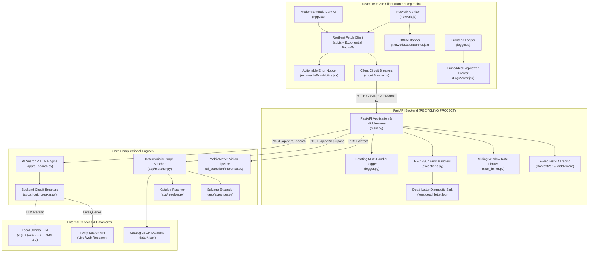

# ReWire — E-Waste Repurposing & Component Recovery Platform
## Complete Technical Architecture, Specification & Setup Documentation

---

## 1. Executive Summary & Mission

**ReWire** is an intelligent, full-stack hardware upcycling platform engineered to combat global electronic waste (e-waste). Every year, tens of millions of metric tons of consumer electronics and industrial circuit boards are discarded, despite containing thousands of operational passives, microcontrollers, display panels, sensors, and power electronics.

ReWire bridges the gap between discarded hardware and high-utility maker projects by providing:
1. **Computer Vision Component Identification**: Automatic identification of discrete electronic parts and devices from camera photos using a fine-tuned MobileNetV3 neural network.
2. **Deterministic Constraint-Satisfaction Matcher**: A local graph engine that analyzes available user inventory, disassembles defective devices into salvaged sub-components, explores pin/spec-compatible substitutions, scores project feasibility, and quantifies grams of diverted e-waste.
3. **AI-Powered Live Research & LLM Reranking**: Augmentation via Tavily live technical web search and Ollama local LLMs (e.g., Qwen 2.5, LLaMA 3.2) to synthesize novel build tutorials and rank community projects.
4. **Resilient High-Availability Architecture**: Full-stack circuit breakers, sliding-window rate limiters, RFC 7807 problem details, exponential backoff retries with jitter, offline detection, and embedded live telemetry.

---

## 2. High-Level System Architecture



---

## 3. Complete Technology Stack

| Layer | Technology | Version | Purpose |
| :--- | :--- | :--- | :--- |
| **Frontend Runtime** | Node.js / React | 18.x / 19.x (ESM) | Single-page reactive application |
| **Frontend Bundler** | Vite | 8.3+ | Lightning-fast HMR and optimized production build |
| **Frontend Styling** | Custom CSS3 | - | Hardware workbench aesthetic (`#071811` emerald, `#b7f67c` accent, `DM Mono`) |
| **Backend Framework** | FastAPI | 0.115+ | High-performance asynchronous REST API |
| **ASGI Server** | Uvicorn | 0.34+ | Asynchronous server implementation |
| **Data Validation** | Pydantic | 2.10+ | Schema validation, serialization, and typing |
| **Deep Learning** | PyTorch & Torchvision | 2.0+ / 0.15+ | MobileNetV3-Small neural network inference |
| **Fuzzy Matching** | RapidFuzz | 3.14+ | C++ accelerated Levenshtein string matching for parts |
| **AI Agents & LLM** | LangChain-Ollama | 0.3+ | Integration with local Ollama model instances |
| **Live Web Search** | Tavily Python SDK | 0.5+ | Live internet knowledge retrieval for hardware builds |
| **Testing Suite** | Pytest & AnyIO | 9.x / 4.x | Complete automated backend test harness (66+ tests) |
| **HTTP Client** | HTTPX | 0.28+ | Async test client and external HTTP requests |

---

## 4. Repository Structure & Key Files

```
c:\dhash\hackathon\SIMATS\backend main\
├── RECYCLING PROJECT/                    # Backend FastAPI Service & ML Pipeline
│   ├── ai_detection/                     # Deep Learning Vision Subsystem
│   │   ├── config.py                     # MobileNetV3 hyperparameters & device setup
│   │   ├── dataset.py                    # PyTorch Dataset loaders with albumentations
│   │   ├── inference.py                  # Real-time image inference with ambiguity rejection
│   │   ├── ingest.py                     # Roboflow & web dataset ingestion pipeline
│   │   ├── model.py                      # MobileNetV3-Small architecture definition
│   │   ├── resolver.py                   # Mapping from neural class IDs to catalog items
│   │   ├── schemas.py                    # Vision inference Pydantic models
│   │   └── train.py                      # Training loop with early stopping & metrics
│   ├── app/                              # Core Application Logic
│   │   ├── ai_search.py                  # Tavily + Ollama LLM reranking engine
│   │   ├── catalog.py                    # In-memory JSON catalog loader and indexes
│   │   ├── circuit_breaker.py            # Thread-safe backend circuit breaker pattern
│   │   ├── config.py                     # Pydantic Settings & environment loader
│   │   ├── exceptions.py                 # RFC 7807 domain exception hierarchy
│   │   ├── expander.py                   # Device salvage component expansion engine
│   │   ├── logger.py                     # Structured rotating multi-handler logger
│   │   ├── main.py                       # FastAPI entrypoint, routes, and exception handlers
│   │   ├── matcher.py                    # Deterministic constraint matching algorithm
│   │   ├── rate_limiter.py               # Sliding-window counter rate limiter
│   │   ├── resolver.py                   # Component alias, SKU, and name resolver
│   │   ├── schemas.py                    # Request and response Pydantic schemas
│   │   ├── validation.py                 # Referential integrity validator for catalogs
│   │   └── waste.py                      # Gram-level e-waste calculation utilities
│   ├── data/                             # Knowledge Base & Catalog Data
│   │   ├── alias_collisions.json         # Catalog alias collision tracking
│   │   ├── catalog_manifest.json         # Versioning and catalog manifest
│   │   ├── component_catalog.json        # 60+ KB of electronic components & specs
│   │   ├── device_salvage_catalog.json   # 250+ KB of electronic devices & salvage yields
│   │   ├── project_catalog.json          # 230+ KB of verified repurposing build projects
│   │   ├── substitution_catalog.json     # Pin and rating compatible component equivalents
│   │   └── validation_report.json        # Catalog health audit report
│   ├── logs/                             # System Telemetry & Diagnostic Sinks
│   │   ├── app.log                       # General application log stream
│   │   ├── error.log                     # Dedicated warning and error log stream
│   │   ├── json.log                      # NDJSON structured telemetry stream
│   │   └── dead_letter.log               # Dead-letter sink for unhandled server exceptions
│   ├── models/mobilenetv3/               # Trained Vision Artifacts
│   │   ├── best_model.pth                # PyTorch neural weights checkpoint
│   │   ├── classes.json                  # Class index to component mapping
│   │   ├── config.json                   # Model input dimensions and normalization
│   │   └── evaluation_report.json        # Confusion matrix and top-1/top-5 accuracy
│   ├── tests/                            # Automated Pytest Suite (66 Tests)
│   │   ├── test_ai_api.py                # AI search endpoint unit tests
│   │   ├── test_ai_resolver.py           # Neural to catalog resolution tests
│   │   ├── test_ai_search_api.py         # Mocked Tavily & Ollama pipeline tests
│   │   ├── test_api.py                   # Core API route & schema tests
│   │   ├── test_catalog.py               # Dataset loading & index verification
│   │   ├── test_exceptions.py            # Error handling, circuit breaker & rate limit tests
│   │   ├── test_expander.py              # Device disassembly graph expansion tests
│   │   ├── test_logger.py                # Multi-handler logging and correlation tests
│   │   ├── test_matcher.py               # Deterministic project matching tests
│   │   ├── test_resolver.py              # Fuzzy component matching tests
│   │   ├── test_validation_coverage.py   # Referential catalog integrity tests
│   │   └── test_waste.py                 # E-waste weight diversion tests
│   ├── .env.example                      # Documented environment variables template
│   └── requirements.txt                  # Python dependency specifications
│
└── frontent org main/                    # React 18 + Vite Web Application
    ├── public/                           # Static assets
    ├── src/
    │   ├── components/
    │   │   ├── ActionableErrorNotice.jsx # Rich RFC 7807 interactive error banner
    │   │   ├── ActionableErrorNotice.css # Error banner styles with tones & animations
    │   │   ├── ErrorBoundary.jsx         # React UI crash recovery boundary
    │   │   ├── ErrorBoundary.css         # ErrorBoundary fallback card styles
    │   │   ├── LogViewer.jsx             # Embedded real-time DevTools log drawer
    │   │   ├── LogViewer.css             # LogViewer styles with filtering and export
    │   │   ├── NetworkStatusBanner.jsx   # Sticky offline detection and connection probe
    │   │   ├── NetworkStatusBanner.css   # Network status banner styling
    │   │   ├── Results.jsx               # Build recommendation cards & YouTube tutorials
    │   │   └── Results.css               # Recommendation layout styles
    │   ├── services/
    │   │   ├── api.js                    # Resilient API client with backoff & retry
    │   │   ├── catalog.js                # Local client-side catalog search & indexing
    │   │   ├── circuitBreaker.js         # Client-side circuit breakers for AI and vision
    │   │   ├── logger.js                 # In-browser multi-level logger with buffer ring
    │   │   └── network.js                # Connectivity monitor with online/offline bus
    │   ├── App.jsx                       # Master workbench application state & layout
    │   ├── main.jsx                      # React 18 DOM mount point
    │   └── styles.css                    # Global hardware workbench CSS design tokens
    ├── index.html                        # HTML5 shell
    ├── package.json                      # Node dependencies & Vite build scripts
    ├── project_context.md                # Complete system architecture & documentation
    └── vite.config.js                    # Vite configuration with proxy rules
```

---

## 5. Core Subsystems & Algorithms

### 5.1 Deterministic Matcher & Salvage Engine
The deterministic engine operates without cloud dependencies, providing immediate offline-capable results.
1. **Inventory Ingestion & Normalization**: User items are classified into `components` and `devices`. Quantities and conditions (`working`, `defective`) are validated.
2. **Recursive Salvage Expansion** (`app/expander.py`):
   * When a defective device is registered (e.g., a broken microwave or defective CRT monitor), the engine looks up its salvage graph in `device_salvage_catalog.json`.
   * It filters out user-flagged defective components, expands the salvage yield, accounts for disassembly difficulty, and adds the salvaged components to the virtual parts pool.
3. **Component Substitution Engine** (`app/matcher.py`):
   * If a target project requires a specific part (e.g., an `LM7805` 5V linear voltage regulator or a `100uF 25V capacitor`), the engine checks `substitution_catalog.json`.
   * Compatible pinouts, higher voltage tolerances, and interchangeable operational ratings are treated as satisfied matches with an audit note.
4. **Feasibility Scoring**:
   * Projects are scored on a scale of $0$ to $100\%$ based on:
     $$\text{Score} = \left(\frac{\text{Critical Satisfied}}{\text{Total Critical}}\right) \times 70 + \left(\frac{\text{Optional Satisfied}}{\text{Total Optional}}\right) \times 30$$
   * Missing parts are compiled into a consolidated bill-of-materials shopping list.
5. **E-Waste Diversion Calculation** (`app/waste.py`):
   * Computes the net weight (in grams) of raw electronic waste diverted from landfills for every project candidate.

### 5.2 AI Computer Vision Inference Subsystem
1. **Neural Model**: MobileNetV3-Small fine-tuned on discrete electronic components (resistors, capacitors, integrated circuits, relays, potentiometers, microcontrollers).
2. **Pre-flight Validation**:
   * Strict 15 MB file size limit enforced before tensor loading.
   * MIME check (`image/jpeg`, `image/png`, `image/webp`, `image/bmp`).
3. **Ambiguity Guard**:
   * Evaluates top-1 probability against `AI_CONFIDENCE_THRESHOLD` (default: $0.55$).
   * Computes delta $\Delta = P_1 - P_2$. If $\Delta < 0.10$, the classification is flagged as ambiguous to prevent misidentifying electrical components with different safety ratings.
4. **Catalog Resolution** (`ai_detection/resolver.py`):
   * Maps neural class names to normalized IDs in `component_catalog.json`.

### 5.3 AI-Powered Research & Reranking Subsystem
1. **Hybrid Retrieval**:
   * Deterministic candidates are filtered and augmented with live web research via the Tavily Search API.
2. **LLM Synthesis**:
   * Passes the user inventory and project templates to Ollama (`qwen2.5:7b` or `llama3.2:3b`).
   * Reranks recommendations based on novelty, tools required, and beginner safety.
3. **Graceful Fallback**:
   * If Tavily or Ollama encounters timeouts, rate limits, or circuit breaker trips, the client automatically offers an immediate one-click fallback to the deterministic matcher.

---

## 6. Advanced Error Handling & Resilience Architecture

The system implements industrial-grade error handling across the entire stack:

### 6.1 Backend Resilience & RFC 7807 Specification
* **RFC 7807 Problem Details**: All API error responses strictly conform to standardized problem details:
  ```json
  {
    "title": "Rate Limit Exceeded",
    "detail": "Too many requests sent in a short time frame.",
    "error_code": "RATE_LIMIT_EXCEEDED",
    "remediation": "Please wait 5 seconds before submitting another request.",
    "request_id": "req-9c84e1b8a21f",
    "timestamp": "2026-10-11T12:05:00.000Z",
    "path": "/detect",
    "details": {
      "limit": 30,
      "window_seconds": 60,
      "retry_after_seconds": 5
    }
  }
  ```
* **Sliding-Window Rate Limiting** (`app/rate_limiter.py`):
  * In-memory sliding-window request tracker protects `/detect` (30 req/min) and `/api/v1/ai_search` (20 req/min).
  * Returns HTTP 429 with `Retry-After` header.
* **Backend Circuit Breakers** (`app/circuit_breaker.py`):
  * Thread-safe circuit breakers for Tavily and Ollama.
  * Trips after 3 consecutive network failures and cools down for 30 seconds before testing recovery in `HALF_OPEN` state.
* **Dead-Letter Diagnostic Sink**:
  * Unhandled server exceptions (`HTTP 500`) are captured in `logs/dead_letter.log` with timestamp, request ID, route, and full exception details.
  * Client disconnects (`asyncio.CancelledError`) are bypassed to avoid phantom server alerts.

### 6.2 Frontend Resilience & Interactive Recovery
* **Client Circuit Breakers** (`src/services/circuitBreaker.js`):
  * Fast-fails requests to `aiSearchBreaker` and `visionBreaker` when upstream services are failing, preventing browser freeze and connection pool exhaustion.
* **Exponential Backoff with Jitter** (`src/services/api.js`):
  * Retries transient network failures, HTTP 502, 503, 504, and rate-limited 429 requests.
  * Formula: $T = \text{retryDelay} \times 2^{\text{attempt}} + \text{random}(0, 200)\text{ms}$.
  * Respects server `Retry-After` header when provided.
* **Network Status Banner** (`src/components/NetworkStatusBanner.jsx`):
  * Sticky banner alerts the user when disconnected from the internet.
  * Explicitly reassures the user that the local ReWire catalog remains fully functional offline.
  * Includes an interactive "Check Connection" probe button.
* **Actionable Error Notice** (`src/components/ActionableErrorNotice.jsx`):
  * Replaces generic alert popups with a rich, interactive error card.
  * Displays: Error code badge, status code, human title, and main message.
  * **Recommended Action**: Clear remediation steps (e.g., "Resize or compress the photo to under 15 MB").
  * **Correlation ID**: Displays `req-xxxx` with a 1-click **Copy ID** button.
  * **Interactive Recovery Buttons**:
    * **↻ Retry Request**: Dynamically displays countdown timer (e.g. "Retry in 4s") for rate-limited requests.
    * **✦ Run Standard ReWire**: Instant fallback to deterministic matching if AI search fails.
* **React ErrorBoundary** (`src/components/ErrorBoundary.jsx`):
  * Wraps results and interactive components. Catches unhandled render crashes, logs telemetry, and allows state reset without losing the user's inventory.

---

## 7. Logging & Observability Architecture

### 7.1 Backend Logging
* **Multi-Destination Rotating Logger** (`app/logger.py`):
  * `logs/app.log`: Rotating stream (10 MB per file, 5 backups) capturing all `INFO+` logs.
  * `logs/error.log`: Rotating stream capturing `WARNING+` and `ERROR+` events.
  * `logs/json.log`: Machine-readable NDJSON format for log aggregators (Elasticsearch / Datadog / Grafana Loki).
  * `logs/dead_letter.log`: Diagnostic sink for unhandled exceptions.
* **Request Correlation Tracing**:
  * Every incoming request receives or generates a unique correlation ID (`X-Request-ID`).
  * Propagated via Python's `contextvars.ContextVar` across all log records, API responses, and exception envelopes.

### 7.2 Frontend In-Browser Telemetry & DevTools
* **Client-Side Module Logger** (`src/services/logger.js`):
  * Log levels: `DEBUG`, `INFO`, `WARN`, `ERROR`, `FATAL`, `PERF`.
  * Circular in-memory buffer ring holding the last 200 events.
* **Embedded Live LogViewer Drawer** (`src/components/LogViewer.jsx`):
  * Built-in developer drawer accessible in the bottom-right corner.
  * Features: Real-time event streaming, level filtering, module filtering, search bar, and one-click JSON log export for debugging bug reports.

---

## 8. REST API Reference

### 8.1 POST `/api/v1/repurpose`
* **Description**: Deterministic recommendation search using catalog constraints and salvage expansion.
* **Rate Limit**: 60 requests/minute.
* **Request Body**:
  ```json
  {
    "items": [
      {
        "name": "resistor_10k",
        "kind": "component",
        "quantity": 4,
        "condition": "working"
      },
      {
        "name": "broken_microwave",
        "kind": "device",
        "quantity": 1,
        "condition": "defective",
        "defective_components": ["magnetron"]
      }
    ],
    "options": {
      "max_results": 10,
      "min_score": 40,
      "max_difficulty": "high",
      "detail": "full",
      "include_best_combination": true
    }
  }
  ```
* **Response (HTTP 200)**:
  ```json
  {
    "summary": {
      "items_recognized": 2,
      "projects_ready": 3,
      "projects_almost": 2,
      "top_waste_reduction_grams": 1450
    },
    "recommendations": [
      {
        "project_id": "proj_high_voltage_supply",
        "project_name": "Variable Bench Power Supply",
        "tier": "ready",
        "feasibility_score": 92.5,
        "difficulty": "medium",
        "estimated_build_time": "2 hours",
        "waste_reduction_grams": 850,
        "requirements": [...],
        "shopping_list": [...],
        "build": {...}
      }
    ]
  }
  ```

### 8.2 POST `/api/v1/ai_search`
* **Description**: AI-assisted recommendation search with live Tavily research and Ollama LLM reranking.
* **Rate Limit**: 20 requests/minute.
* **Request Body**: Same schema as `/api/v1/repurpose`.
* **Response (HTTP 200)**: Same schema as `/api/v1/repurpose`, with additional AI research summaries, community links, and LLM-synthesized build notes.

### 8.3 POST `/detect` (and alias `/api/v1/detect`)
* **Description**: Vision inference on uploaded component or hardware image.
* **Rate Limit**: 30 requests/minute.
* **Max Payload**: 15 MB.
* **Request**: `multipart/form-data` with field `image` (JPEG, PNG, WEBP, or BMP).
* **Response (HTTP 200)**:
  ```json
  {
    "status": "success",
    "resolved": true,
    "normalized_inventory": {
      "name": "electrolytic_capacitor_100uf",
      "type": "component"
    },
    "prediction": {
      "class_id": 4,
      "class_name": "capacitor_electrolytic",
      "confidence": 0.892,
      "ambiguous": false
    }
  }
  ```

---

## 9. Setup & Installation Guide

### Prerequisites
* **Operating System**: Windows 10/11, macOS, or Linux (Ubuntu 22.04+ recommended).
* **Python**: Python 3.10 to 3.13.
* **Node.js**: Node.js 18.x or 20.x+ with `npm`.
* **Ollama (Optional for AI-ReWire)**: [Install Ollama](https://ollama.ai) and pull a model:
  ```bash
  ollama run qwen2.5:7b
  ```

---

### 9.1 Backend Setup (`RECYCLING PROJECT`)

1. **Navigate to the backend directory**:
   ```bash
   cd "c:\dhash\hackathon\SIMATS\backend main\RECYCLING PROJECT"
   ```

2. **Create and activate a virtual environment**:
   * *Windows (PowerShell)*:
     ```powershell
     python -m venv myenv
     .\myenv\Scripts\Activate.ps1
     ```
   * *Linux / macOS*:
     ```bash
     python3 -m venv myenv
     source myenv/bin/activate
     ```

3. **Install dependencies**:
   ```bash
   pip install --upgrade pip
   pip install -r requirements.txt
   ```

4. **Configure Environment Variables**:
   * Copy the `.env.example` file to `.env`:
     ```bash
     cp .env.example .env
     ```
   * Key configuration parameters:
     ```env
     CATALOG_STRICT=true
     AI_MODEL=qwen2.5:7b
     TAVILY_API_KEY=tvly-your-tavily-api-key-here
     AI_CONFIDENCE_THRESHOLD=0.55
     AI_AMBIGUITY_DELTA=0.10
     AI_IMAGE_SIZE=224
     AI_DEVICE=
     ```

5. **Run the Backend Server**:
   ```bash
   uvicorn app.main:app --host 127.0.0.1 --port 8000 --reload
   ```
   * API documentation available at: `http://127.0.0.1:8000/docs`
   * OpenAPI schema available at: `http://127.0.0.1:8000/openapi.json`

---

### 9.2 Frontend Setup (`frontent org main`)

1. **Navigate to the frontend directory**:
   ```bash
   cd "c:\dhash\hackathon\SIMATS\backend main\frontent org main"
   ```

2. **Install Node packages**:
   ```bash
   npm install
   ```

3. **Start the Vite Development Server**:
   ```bash
   npm run dev
   ```
   * The app will launch at: `http://localhost:5173`
   * Vite proxies all `/api` and `/detect` requests to `http://127.0.0.1:8000`.

4. **Build for Production**:
   ```bash
   npm run build
   ```
   * Builds the optimized static assets to `dist/`.

---

## 10. Testing & Verification

### Running the Backend Pytest Suite
From the backend directory with virtual environment activated:
```bash
pytest tests -v
```

Expected output:
```
============================= test session starts =============================
platform win32 -- Python 3.13.16, pytest-9.1.1
collected 66 items

tests\test_ai_api.py ..........                                          [ 15%]
tests\test_ai_resolver.py ..........                                     [ 30%]
tests\test_ai_search_api.py .........                                    [ 43%]
tests\test_api.py ................                                       [ 68%]
tests\test_catalog.py .                                                  [ 69%]
tests\test_exceptions.py .........                                       [ 83%]
tests\test_expander.py ..                                                [ 86%]
tests\test_logger.py ...                                                 [ 90%]
tests\test_matcher.py .                                                  [ 92%]
tests\test_resolver.py ..                                                [ 95%]
tests\test_validation_coverage.py ..                                     [ 98%]
tests\test_waste.py .                                                    [100%]

============================= 66 passed in 9.23s ==============================
```

### Testing Error Handling & Resilience Specifically
```bash
pytest tests/test_exceptions.py -v
```
Verifies:
* Exception hierarchy and RFC 7807 problem details serialization.
* Custom correlation ID propagation via headers.
* 422 Request validation envelope.
* 413 Image size limit rejection.
* Remediation advice and human titles in error envelopes.
* Circuit breaker trips on consecutive errors and resets on recovery.
* Sliding-window rate limiter blocking bursts with HTTP 429 and `Retry-After`.

---

## 11. Security, Performance & Production Best Practices

1. **DoS & Flood Prevention**:
   * Sliding-window rate limiters prevent API abuse on resource-intensive machine learning routes.
   * File uploads are size-capped at 15 MB and validated by magic byte MIME inspection before processing.
2. **Cascading Failure Protection**:
   * Both frontend and backend circuit breakers decouple external dependencies (Tavily Search and Ollama LLM) from the core catalog matching engine.
   * If external AI providers go down, users can seamlessly use deterministic matching without interruption.
3. **Data Integrity & Schema Strictness**:
   * Startup catalog validation (`CATALOG_STRICT=true`) ensures that no broken component references or missing salvage items degrade match results.
4. **Zero-Tracking Privacy**:
   * Local deterministic matching and local Ollama inference ensure that sensitive enterprise component inventories never leave the local environment unless cloud AI features are explicitly enabled.

---

## 12. Future Roadmap

* **Live Video Streaming Detection**: Real-time bounding box detection via WebRTC or WebSocket to identify parts continuously as circuit boards pass under a webcam.
* **Community Project Contributions**: Git-backed catalog submission pipeline allowing makers to propose new repurposing projects with verified schematic files and video links.
* **Automated PCB Schematic Parsing**: Ingest Gerber files and KiCad project schematics to automatically populate part inventories from legacy PCB designs.
